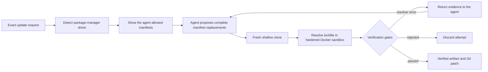

<p align="center">
  
</p>

<p align="center">
  <strong>Let the agent negotiate the upgrade. Let deterministic gates make the call.</strong>
</p>

<p align="center">
  <a href="https://github.com/Pirikara/bumpire/actions/workflows/ci.yml"></a>
  <a href="./pyproject.toml"></a>
  <a href="./LICENSE"></a>
  <a href="https://docs.litellm.ai/"></a>
  <a href="https://www.docker.com/"></a>
</p>

---

Bumpire is an experimental dependency updater for upgrades that require reasoning—not
just changing one version string. An LLM proposes coordinated manifest edits, while a
fixed workflow resolves the lockfile in Docker and accepts the result only when every
deterministic gate passes.

Bumpire deliberately does not decide why an update should happen or which version should
be requested. A human, scheduler, dependency service, or security scanner supplies exact
package versions; Bumpire owns the constrained planning, resolution, and verification.

It handles cases such as:

- an npm update blocked by a local package's exact `peerDependencies`;
- a Rails component pinned to the exact version of the parent `rails` gem;
- an initial proposal rejected by the package manager, requiring another agent turn.

> [!IMPORTANT]
> Bumpire is an early-stage experiment. It can generate a verified patch or publish a
> GitHub draft pull request. Private registry authentication is not implemented yet.

## Why Bumpire?

Traditional dependency bots are excellent when a package can be updated in isolation.
The interesting failures happen when the requested version is only one piece of a larger
constraint graph.

| | Traditional updater | Bumpire |
|---|---|---|
| Discovers what should be updated | Yes | **No — caller-supplied** |
| Coordinates related manifest constraints | Rule-dependent | Agent-planned |
| Learns from resolver errors | Limited | Feeds evidence into the next turn |
| Executes arbitrary agent commands | N/A | **No** |
| Trusts the model's success claim | N/A | **Never** |
| Accepts only a resolved, allowlisted diff | Varies | **Always** |

The model decides what to try. Bumpire decides what is allowed and whether it worked.

## How it works



Most of this is intentionally a workflow. The agentic part is the closed loop between
planning an edit and reacting to package-manager evidence. Cloning, command execution,
file permissions, version checks, and termination remain deterministic.

## Quick start

### Requirements

- Python 3.12+
- [uv](https://docs.astral.sh/uv/)
- Docker with a running daemon
- an API key for any [LiteLLM-supported provider](https://docs.litellm.ai/docs/providers)
- [GitHub CLI](https://cli.github.com/) authenticated for repositories used with `publish`

### Install from source

```bash
git clone https://github.com/Pirikara/bumpire.git
cd bumpire
uv sync
```

### Generate a verified patch

```bash
export OPENROUTER_API_KEY="..."

uv run bumpire preview \
  --repo ../your-project \
  --target lodash 4.18.1 \
  --model openrouter/openrouter/free \
  --output bumpire.patch \
  --artifact-output bumpire-artifact.json
```

Bumpire never modifies the supplied working tree. Every attempt runs in a temporary
clone, and only the staged diff from a successful attempt is returned.

The supplied repository must be clean. Inspection records its full HEAD object ID, and
every resolver attempt checks out that exact commit even if the source branch moves while
the agent is running.

To update multiple packages as one coherent operation, repeat `--target`. The batch is
atomic: Bumpire returns a patch only when every resolved occurrence equals its requested
version.

```bash
uv run bumpire preview \
  --repo ../your-rails-project \
  --target rails 7.2.3.2 \
  --target activestorage 7.2.3.2 \
  --model openrouter/openrouter/free \
  --output bumpire.patch
```

### Exact targets

Every target is an exact identity requirement. A leading `==` is accepted only as
optional notation:

```bash
--target rails 7.2.3.2
--target activestorage '==7.2.3.2'
```

Bumpire compares the version strings emitted by the package-manager driver. It does not
implement SemVer, RubyGems ordering, ranges, minimum-safe-version semantics, or target
removal. Those are concerns of the caller selecting the exact desired result.

> [!NOTE]
> Version 0.4 introduces exact-only requests and verified artifact schema v2. Artifacts
> generated by 0.3 or earlier must be regenerated before publishing.

### Publish a draft pull request

Use `publish` with the same update inputs to verify the update, push a dedicated branch,
and open a GitHub draft pull request:

```bash
uv run bumpire publish \
  --repo ../your-project \
  --target lodash 4.18.1 \
  --model openrouter/openrouter/free
```

Publishing is deliberately conservative:

- the remote base branch must still point to the artifact's verified commit;
- the patch is reapplied in a fresh clone and its digest and changed files are rechecked;
- branch names are deterministic, so a retry reuses an identical branch and pull request;
- a branch collision with different content is rejected;
- pull requests are always created as drafts and are never merged by Bumpire.

Git credentials remain in the publisher process. They are not passed to the model or the
resolver container.

If pushing succeeds but pull-request creation is interrupted, retry from the exact saved
evidence instead of asking the model for another proposal:

```bash
uv run bumpire publish \
  --repo ../your-project \
  --artifact-input bumpire-artifact.json
```

Use `--workspace path/to/app` for a package nested inside a monorepo. If multiple
profiles match the same workspace, select one explicitly with `--ecosystem` followed by
`npm`, `pnpm`, `yarn`, `bun`, or `bundler`.

## What gets verified

| Bumpire's acceptance gate | Your repository's CI |
|---|---|
| Dependency graph resolves | Unit and integration tests |
| Every resolved occurrence of every target equals its exact requested version | Build, lint, and type checking |
| Every requested target remains in the resolved graph | Application dependency requirements |
| Only profile-allowlisted files changed | Application behavior |
| Agent did not edit the lockfile directly | API and runtime compatibility |
| A non-empty staged diff exists | Deployment readiness |

Resolver success is deliberately narrow. Bumpire does not claim that the application is
compatible; when the patch is included in a pull request, rely on the destination
repository's CI for that judgment.

All targets in one request must belong to the same package-manager profile and workspace.
Cross-ecosystem or cross-workspace campaigns should be split into separate patches.

## Verified update artifact

Successful updates can be exported as JSON with `--artifact-output`. The artifact binds:

- the full base commit and branch name;
- the workspace, ecosystem, and package-manager profile;
- the complete caller-supplied update request;
- deterministic evidence for every requested target;
- a sorted changed-file list;
- the staged patch and its SHA-256 digest.

The schema rejects altered patch content, incomplete target evidence, failed target
verification, and inconsistent request metadata. This artifact is the handoff boundary
to the GitHub publisher; it is not an agent-authored success claim.

## Package-manager driver boundary

Bumpire does not implement an update strategy for each ecosystem. The agent plans
manifest edits and learns from the real package manager's errors. A small trusted driver
only exposes the deterministic mechanics the core cannot safely invent or delegate to a
model.

Each driver has the same narrow contract:

1. detect its workspace and enumerate agent-editable manifests;
2. run one fixed resolver procedure;
3. emit requested packages as normalized JSON:

   ```json
   {"schema_version": 1, "packages": {"lodash": ["4.18.1"]}}
   ```

The graph extractor runs with no network and a read-only workspace. The resolver runs in
the writable disposable clone. Neither command, image, nor success condition can be
selected by the model.

The built-in drivers are declarative TOML files rather than package-manager-specific
Python adapters.

| Driver | Detection | Agent-editable surface | Trusted resolver | Graph reader |
|---|---|---|---|---|
| npm | `package.json` + `package-lock.json` | Dependency-related JSON sections | `npm install --package-lock-only --ignore-scripts` | JSON via Node.js |
| pnpm | `package.json` + `pnpm-lock.yaml` | Dependency-related JSON sections | `pnpm install --lockfile-only --ignore-scripts` | Lockfile graph via Node.js |
| Yarn Classic / Berry | `package.json` + `yarn.lock` | Dependency-related JSON sections | Version-pinned `yarn install` with scripts disabled | Classic and Berry lockfile reader |
| Bun | `package.json` + `bun.lock` | Dependency-related JSON sections | `bun install --lockfile-only --ignore-scripts` | Bun's native JSONC reader |
| Bundler | `Gemfile` + `Gemfile.lock` | `gem` declaration lines | `bundle lock` | `Bundler::LockfileParser` |

Bun's legacy binary `bun.lockb` is intentionally unsupported; migrate it to the current
text-based `bun.lock` before using Bumpire. Pin pnpm, Yarn, and Bun with the
`packageManager` field when reproducible package-manager selection matters. Yarn projects
that load custom plugins from `.yarnrc.yml` are rejected because those plugins execute
repository-controlled code inside the resolver.

A driver profile defines:

- workspace detection and manifest globs;
- the mutable region inside a manifest;
- lockfiles the resolver may update;
- runtime-version discovery and the Docker image;
- the trusted resolver procedure;
- a normalized resolved-graph extractor;
- package-manager guidance for the agent.

Adding an ecosystem should normally mean adding one file under
[`bumpire/profiles`](./bumpire/profiles/). It still requires trusted knowledge of how to
invoke that package manager and read its result, but not a new graph-solving algorithm or
Python adapter. Python changes are reserved for genuinely new safety primitives such as
a different sandbox or authentication mechanism.

## Constraint-heavy examples

### npm peer dependency conflict

Given a root dependency on `lodash@4.17.20` and a local package whose peer dependency is
also pinned to exactly `4.17.20`, Bumpire coordinates both edits in one attempt:

```diff
 // package.json
-"lodash": "4.17.20"
+"lodash": "4.18.1"

 // packages/peer-consumer/package.json
-"lodash": "4.17.20"
+"lodash": "4.18.1"
```

The npm profile regenerates `package-lock.json`, verifies the resolved version, and
rejects any unrelated file change.

### Rails / Active Storage

When an application requests an `activestorage` update but depends on the umbrella Rails
gem, the component cannot be bumped independently because Rails pins every component to
its exact version. Bumpire updates the direct parent instead:

```diff
-gem "rails", "7.2.3.1"
+gem "rails", "7.2.3.2"
```

Bundler then resolves `activestorage` and the other Rails components to `7.2.3.2`.

## Security boundaries

- Each candidate runs in a fresh shallow clone with Git hooks disabled.
- Every candidate is pinned to the commit inspected before planning began.
- The resolver runs as the host UID/GID in a read-only-root Docker container.
- Linux capabilities are dropped and `no-new-privileges` is enabled.
- CPU, memory, process, and temporary-storage limits are applied.
- `.git` is mounted read-only inside the container.
- npm, pnpm, Yarn, and Bun lifecycle scripts are disabled during lockfile resolution.
- The agent cannot choose the image, shell command, lockfile, or success condition.
- Staged, unstaged, and untracked files are all checked against an allowlist.
- The original repository is never modified.

Registry access currently uses Docker's normal bridge network. Registry allowlisting and
private registry credentials are roadmap items.

## Model providers

Bumpire uses the OpenAI Agents SDK for tool-loop orchestration and LiteLLM for model
routing. It is not tied to OpenAI models.

```bash
# OpenRouter
uv run bumpire preview ... --model openrouter/openrouter/free

# Gemini
uv run bumpire preview ... --model gemini/gemini-2.5-flash

# Local Ollama
uv run bumpire preview ... --model ollama_chat/qwen3
```

Provider-standard environment variables are picked up automatically. Alternatively,
store a key under any environment variable and pass its name with
`--api-key-env MY_PROVIDER_API_KEY`. Prompt bodies are not emitted through LiteLLM's
logging hooks.

## Development

```bash
uv sync
uv run ruff check bumpire tests
uv run pytest -q
BUMPIRE_DRIVER_CONFORMANCE=1 uv run pytest -q tests/test_driver_conformance.py
uv build
```

The driver conformance suite executes each trusted graph reader in a networkless,
read-only Docker mount and exercises each JavaScript resolver in a writable disposable
workspace. CI runs it as a separate required job.

## License

Licensed under the [Apache License 2.0](./LICENSE).
