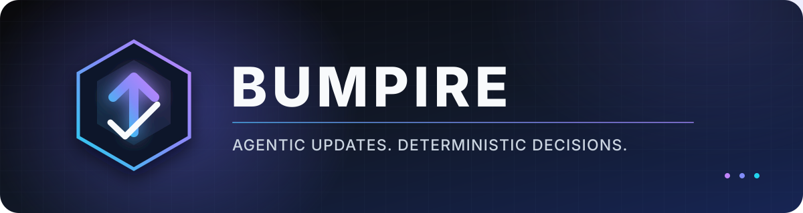
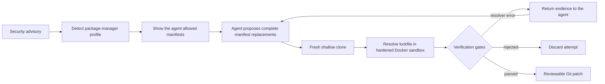

<p align="center">
  
</p>

<p align="center">
  <strong>Let the agent negotiate the upgrade. Let deterministic gates make the call.</strong>
</p>

<p align="center">
  <a href="https://github.com/Pirikara/bumpire/actions/workflows/ci.yml"></a>
  <a href="./pyproject.toml"></a>
  <a href="./LICENSE"></a>
  <a href="https://docs.litellm.ai/"></a>
  <a href="https://www.docker.com/"></a>
</p>

---

Bumpire is an experimental dependency updater for upgrades that require reasoning—not
just changing one version string. An LLM proposes coordinated manifest edits, while a
fixed workflow resolves the lockfile in Docker and accepts the result only when every
deterministic gate passes.

It handles cases such as:

- a vulnerable npm package blocked by a local package's exact `peerDependencies`;
- a vulnerable Rails component pinned to the exact version of the parent `rails` gem;
- an initial proposal rejected by the package manager, requiring another agent turn.

> [!IMPORTANT]
> Bumpire is an early-stage experiment. It currently generates a verified patch; branch
> creation, GitHub pull requests, private registry authentication, and post-update
> vulnerability scanning are not implemented yet.

## Why Bumpire?

Traditional dependency bots are excellent when a package can be updated in isolation.
The interesting failures happen when the requested version is only one piece of a larger
constraint graph.

| | Traditional updater | Bumpire |
|---|---|---|
| Chooses a target version | Yes | Yes |
| Coordinates related manifest constraints | Rule-dependent | Agent-planned |
| Learns from resolver errors | Limited | Feeds evidence into the next turn |
| Executes arbitrary agent commands | N/A | **No** |
| Trusts the model's success claim | N/A | **Never** |
| Accepts only a resolved, allowlisted diff | Varies | **Always** |

The model decides what to try. Bumpire decides what is allowed and whether it worked.

## How it works



Most of this is intentionally a workflow. The agentic part is the closed loop between
planning an edit and reacting to package-manager evidence. Cloning, command execution,
file permissions, version checks, and termination remain deterministic.

## Quick start

### Requirements

- Python 3.12+
- [uv](https://docs.astral.sh/uv/)
- Docker with a running daemon
- an API key for any [LiteLLM-supported provider](https://docs.litellm.ai/docs/providers)

### Install from source

```bash
git clone https://github.com/Pirikara/bumpire.git
cd bumpire
uv sync
```

### Generate a verified patch

```bash
export OPENROUTER_API_KEY="..."

uv run bumpire preview \
  --repo ../your-project \
  --package lodash \
  --safe-version 4.18.1 \
  --model openrouter/openrouter/free \
  --output bumpire.patch
```

Bumpire never modifies the supplied working tree. Every attempt runs in a temporary
clone, and only the staged diff from a successful attempt is returned.

To remediate multiple packages as one coherent update, repeat `--target`. The batch is
atomic: Bumpire returns a patch only when every target reaches its minimum version (or
is removed from the resolved dependency graph).

```bash
uv run bumpire preview \
  --repo ../your-rails-project \
  --target rails 7.2.3.2 \
  --target activestorage 7.2.3.2 \
  --model openrouter/openrouter/free \
  --output bumpire.patch
```

`--package` with `--safe-version` remains available as a single-target shorthand.

Use `--workspace path/to/app` for a package nested inside a monorepo. If multiple
profiles match the same workspace, select one explicitly with `--ecosystem npm` or
`--ecosystem bundler`.

## What gets verified

| Bumpire's acceptance gate | Your repository's CI |
|---|---|
| Dependency graph resolves | Unit and integration tests |
| Every occurrence of every target reaches its minimum version, or is removed | Build, lint, and type checking |
| Only profile-allowlisted files changed | Application behavior |
| Agent did not edit the lockfile directly | API and runtime compatibility |
| A non-empty staged diff exists | Deployment readiness |

Resolver success is deliberately narrow. Bumpire does not claim that the application is
compatible; when the patch is included in a pull request, rely on the destination
repository's CI for that judgment.

All targets in one request must belong to the same package-manager profile and workspace.
Cross-ecosystem or cross-workspace campaigns should be split into separate patches.

## Built-in profiles

Bumpire uses declarative TOML profiles instead of package-manager-specific Python
adapters.

| Ecosystem | Detection | Agent-editable surface | Trusted resolver |
|---|---|---|---|
| npm | `package.json` + `package-lock.json` | Dependency-related JSON sections | `npm install --package-lock-only --ignore-scripts` |
| Bundler | `Gemfile` + `Gemfile.lock` | `gem` declaration lines | `bundle lock` |

A profile defines:

- workspace detection and manifest globs;
- the mutable region inside a manifest;
- lockfiles the resolver may update;
- runtime-version discovery and the Docker image;
- the trusted resolver procedure;
- resolved-version extraction;
- package-manager guidance for the agent.

Adding an ecosystem should normally mean adding one file under
[`bumpire/profiles`](./bumpire/profiles/). Python changes are reserved for genuinely new
safety primitives such as a different sandbox or authentication mechanism.

## Constraint-heavy examples

### npm peer dependency conflict

Given a root dependency on `lodash@4.17.20` and a local package whose peer dependency is
also pinned to exactly `4.17.20`, Bumpire coordinates both edits in one attempt:

```diff
 // package.json
-"lodash": "4.17.20"
+"lodash": "4.18.1"

 // packages/peer-consumer/package.json
-"lodash": "4.17.20"
+"lodash": "4.18.1"
```

The npm profile regenerates `package-lock.json`, verifies the resolved version, and
rejects any unrelated file change.

### Rails / Active Storage

When `activestorage` is vulnerable but the application depends on the umbrella Rails gem,
the component cannot be bumped independently because Rails pins every component to its
exact version. Bumpire updates the direct parent instead:

```diff
-gem "rails", "7.2.3.1"
+gem "rails", "7.2.3.2"
```

Bundler then resolves `activestorage` and the other Rails components to `7.2.3.2`.

## Security boundaries

- Each candidate runs in a fresh shallow clone with Git hooks disabled.
- The resolver runs as the host UID/GID in a read-only-root Docker container.
- Linux capabilities are dropped and `no-new-privileges` is enabled.
- CPU, memory, process, and temporary-storage limits are applied.
- `.git` is mounted read-only inside the container.
- npm lifecycle scripts are disabled during lockfile resolution.
- The agent cannot choose the image, shell command, lockfile, or success condition.
- Staged, unstaged, and untracked files are all checked against an allowlist.
- The original repository is never modified.

Registry access currently uses Docker's normal bridge network. Registry allowlisting and
private registry credentials are roadmap items.

## Model providers

Bumpire uses the OpenAI Agents SDK for tool-loop orchestration and LiteLLM for model
routing. It is not tied to OpenAI models.

```bash
# OpenRouter
uv run bumpire preview ... --model openrouter/openrouter/free

# Gemini
uv run bumpire preview ... --model gemini/gemini-2.5-flash

# Local Ollama
uv run bumpire preview ... --model ollama_chat/qwen3
```

Provider-standard environment variables are picked up automatically. Alternatively,
store a key under any environment variable and pass its name with
`--api-key-env MY_PROVIDER_API_KEY`. Prompt bodies are not emitted through LiteLLM's
logging hooks.

## Development

```bash
uv sync
uv run ruff check bumpire tests
uv run pytest -q
uv build
```

## License

Licensed under the [Apache License 2.0](./LICENSE).
